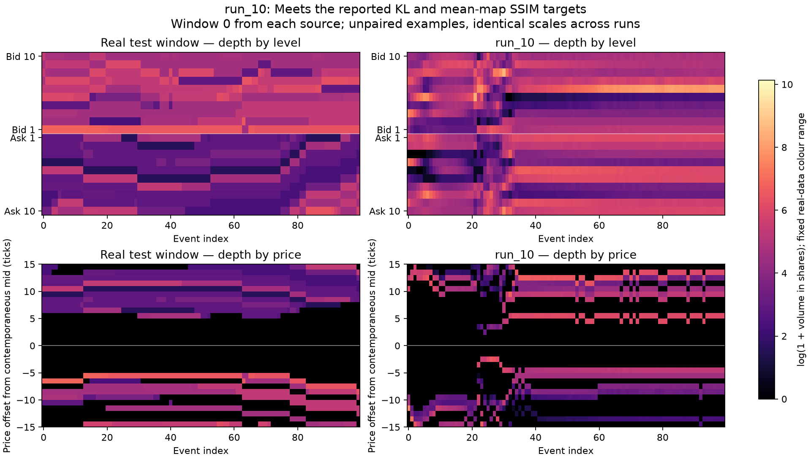

# TimeGAN limit-order-book experiments

TimeGAN generates 100-event limit-order-book sequences from LOBSTER AMZN data. This comparison covers run_01–run_08 and run_10. Run identifiers label experiments; they do not imply training order.

## Results

Targets: **KL <= 0.1** for spreads and returns, and **SSIM > 0.6**. KL is measured as `KL(real || generated)` using shared histograms.

| Run | KL spread | KL 1-step return | KL 10-step return | Mean SSIM levels | Mean SSIM prices | Pair SSIM levels | Pair SSIM prices |
|---|---:|---:|---:|---:|---:|---:|---:|
| run_01 | — | — | — | — | — | — | — |
| run_02 | 0.6169 | 1.4762 | 0.6853 | 0.7585 | 0.4444 | 0.0779 | 0.0516 |
| run_03 | 0.8011 | 0.4372 | 0.5783 | 0.5268 | 0.2261 | 0.1364 | 0.1240 |
| run_04 | 10.7452 | 4.0622 | — | 0.0337 | -0.0366 | 0.0107 | 0.0722 |
| run_05 | 4.4014 | 2.0789 | 10.6326 | 0.3577 | -0.0479 | 0.0096 | 0.1170 |
| run_06 | 0.3437 | 0.0595 | 0.0207 | 0.7645 | 0.6375 | 0.1019 | 0.1600 |
| run_07 | 0.1923 | 0.0783 | 0.0157 | 0.7955 | 0.7343 | 0.0897 | 0.1422 |
| run_08 | 0.4085 | 0.0952 | 0.0437 | 0.8123 | 0.5692 | 0.0999 | 0.1443 |
| run_10 | 0.0986 | 0.0524 | 0.0433 | 0.8178 | 0.6929 | 0.1134 | 0.1457 |

[Download the results table](results/run_metrics.csv).

**run_10 meets all three KL targets and both mean-heatmap SSIM targets.** run_06, run_07, and run_08 meet the return KL targets but miss the spread target. run_07 has the highest price-indexed mean SSIM among the runs shown.

Mean-heatmap SSIM compares average depth profiles across 500 windows. Pair SSIM compares individual, unpaired real and generated windows. These measure different properties: **none of the runs shown achieves pair SSIM above 0.6**. The mean-map results therefore do not establish realistic individual event dynamics.

`—` means unavailable. run_01 uses an earlier 40-feature representation and cannot be evaluated with the current 42-feature decoder. run_04 produces no usable ten-step return samples, so that entry is undefined rather than a pass.

## Order-book examples

The following figures use **generated window 0** and **real test window 0** for every run. These are unpaired examples, chosen by index rather than visual quality. Each figure shows depth by level and depth by price relative to the contemporaneous midprice. Every figure uses the same real-data colour range and the same ±15-tick price band. Volumes outside the colour range saturate; prices outside the band are not displayed. Empty cells denote no displayed volume.

### run_02: large return-distribution mismatch

Spread and return KL exceed the targets. The two depth representations help distinguish a plausible average level profile from the placement of liquidity around the midprice.


### run_04: severe failure

Spread KL is 10.7452 and price-indexed mean SSIM is negative. The level view still exposes generated volume when the price-band view contains little or no displayed liquidity.


### run_06: improved returns, remaining spread mismatch

Both return KL scores pass, and both mean-map SSIM scores exceed 0.6. Spread KL remains 0.3437.


### run_07: strong average depth structure

Price-indexed mean SSIM reaches 0.7343. Return KL passes, while spread KL remains above target at 0.1923.


### run_10: strongest combined metric result

Spread KL is 0.0986, one-step return KL is 0.0524, and ten-step return KL is 0.0433. Mean SSIM is 0.8178 by level and 0.6929 by price. Individual-window similarity remains low despite these aggregate improvements.



## Model and development notes

The model combines an embedder, recoverer, generator, supervisor, and discriminator. Autoencoder pretraining learns the feature representation; supervisor pretraining learns next-step latent dynamics; joint adversarial training learns generation and reconstruction together.

The representation expanded from 40 features in run_01 to 42 in the evaluated runs: ten levels of ask/bid price gaps and log volumes, plus asinh midprice change and log inter-event time. This supports explicit spread, return, and event-time analysis. Detailed training settings were not retained for these early experiments, so the score changes cannot reliably be attributed to individual loss weights or optimisation changes.

## Evaluation protocol

- Train: 09:30–13:00; validation: 13:00–14:30; test: 14:30–16:00, from the same AMZN trading day.
- Each evaluated run generates 500 windows with seed 123, a 20-event warm-up, the same quote decoder, and no sparsification.
- Spread KL uses real-data quantile bins; one-step return KL uses half-tick bins; ten-step return KL uses real-data quantile bins. All runs use the same real test reference.
- The figures illustrate single windows; the scores summarise the full evaluation set. Neither the figures nor passing histogram scores establish that event sparsity and temporal dependence are correct.

## Plotting

With the local evaluation arrays and LOBSTER data available:

```bash
venv/bin/python plot_notable_orderbooks.py
```

Training losses can be plotted from saved console output:

```bash
venv/bin/python plot_losses.py print_log.txt
venv/bin/python plot_selected_losses.py print_log.txt
```
