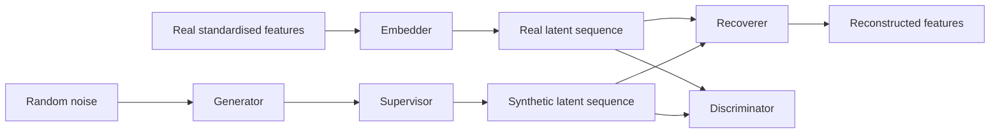

# TimeGAN limit-order-book experiments

TimeGAN generates 100-event limit-order-book sequences from LOBSTER AMZN data.

## Model overview

The model adapts TimeGAN, introduced by Yoon, Jarrett, and van der Schaar in [*Time-series Generative Adversarial Networks* (NeurIPS 2019)](https://papers.neurips.cc/paper_files/paper/2019/hash/c9efe5f26cd17ba6216bbe2a7d26d490-Abstract.html), a recurrent generative adversarial framework for sequences. It learns both a representation of real order books and the temporal relationships between events. A generator then creates synthetic sequences in that learned representation, and a recoverer converts them back into order-book features. Generation starts from random noise; it does not require a real order-book window as input.

### Input features

Each input is a window of 100 consecutive events, with 42 features per event:

| Features | Representation | Purpose |
|---|---|---|
| Ask and bid prices at ten levels | 20 gaps measured in ticks | Describe book geometry relative to the midprice rather than absolute price. The first gap on each side is its distance from the midprice; deeper gaps are increments between levels. |
| Ask and bid volumes at ten levels | 20 `log(1 + volume)` values | Reduce the scale difference between small and large displayed sizes. |
| Midprice change | `asinh(change in ticks)` | Preserve the direction of price movement while reducing the influence of large moves. The first change in a window is zero. |
| Inter-event time | `log(1 + time in microseconds)` | Represent the wide range of delays between events. |

Each feature channel is standardised using a mean and standard deviation fitted on training data only. These same statistics are used for validation and generation. Empty levels and invalid price sentinels are handled during feature construction.

### Architecture

The implemented architecture uses 128 latent channels and 64 noise channels at each event. The recurrent layers are gated recurrent units (GRUs), which carry information from earlier events forward through the window.

| Component | Network | Role |
|---|---|---|
| Embedder | Two-layer GRU → linear layer → sigmoid | Maps 42 observed features into 128 learned latent channels per event. |
| Recoverer | Two-layer GRU → linear layer | Maps latent sequences back to 42 standardised features, with an unconstrained output. |
| Generator | Two-layer GRU → linear layer → sigmoid | Maps 64-channel random-noise sequences into synthetic latent sequences. |
| Supervisor | One-layer GRU → linear layer → sigmoid | Learns next-event latent dynamics and transforms the generator's latent output before recovery. |
| Discriminator | Two-layer GRU → linear layer | Produces real/fake logits at each event in latent space, providing the adversarial training signal. |

### How embedding and recovery work

For a batch of windows, the embedder changes the tensor shape from batch × 100 × 42 to batch × 100 × 128. Each latent vector reflects the current features and preceding events processed by the GRU. These channels are learned jointly rather than assigned to individual prices or volumes. This is a change of representation, not dimensional compression: the latent width is larger than the input width.

The recoverer processes that latent sequence and produces batch × 100 × 42 reconstructed features. Reconstruction training encourages embedding and recovery to retain the information needed to reproduce the original book. The supervisor is trained to predict the next real latent state from the sequence up to the current event, encouraging temporal structure beyond reconstruction alone.

During generation, noise passes through the generator, supervisor, and the same recoverer. The resulting features are first unstandardised, then converted to physical quantities: volume and time transforms are inverted, price changes are accumulated from an initial midprice, and price gaps are assembled into ask and bid levels. Sizes are rounded to integer shares and prices to the tick grid. The decoder enforces a spread of at least one tick and ordered deeper prices; these constraints come from decoding rules rather than proving the network learned them unaided.

### Training stages

1. Reconstruction pretraining: train the embedder and recoverer to reproduce real features.
2. Supervisor pretraining: train next-event prediction on real latent sequences.
3. Joint training: alternate generator/supervisor, embedder/recoverer, and discriminator updates. Adversarial and statistical objectives encourage synthetic sequences to match real distributions and temporal behaviour. Optional volume-event reconstruction terms are available but disabled in the restored preset.

The embedder and discriminator are used during training; synthetic features are produced by the generator → supervisor → recoverer path. Training settings vary across experiments, so the results below compare runs rather than isolate a single architectural change.

## Training hyperparameters

| Setting | Value |
|---|---|
| Events per window / input features | 100 / 42 |
| Hidden width / noise width | 128 / 64 |
| GRU layers | 2 for E/R/G/D; 1 for the supervisor |
| Batch size | 128 |
| Optimiser | Adam, learning rate 0.001, betas (0.9, 0.999) |
| Initialisation | PyTorch defaults |
| Noise | Uniform marginals; half AR(1)-correlated with rho 0.7, half constant within each sequence |
| Moment matching | Across the batch at each timestep |
| Discriminator inputs | Raw latent values |
| Autoencoder / supervisor / joint epochs | 100 / 100 / 200 |
| Training batches per epoch | Up to 200, sampled without replacement |
| G/S and E/R updates per discriminator step | 2 each |
| Discriminator update threshold | Summed discriminator loss > 0.6 |
| Fake-generator discriminator branch coefficient (gamma) | 1 |
| EMA decay | 0.999 for generator, supervisor, and recoverer |
| Random seed | 69 |
| Scaler fitting stride | Every 10th training window |
| Validation subset | Up to 2,560 evenly spaced windows |
| Model selection | Minimum validation moment/roughness/correlation/autocorrelation/within-window discrepancy after epoch 30 |
| Validation generation warm-up | 0 events |

Effective joint generator/supervisor loss coefficients:

| Loss term | Coefficient |
|---|---:|
| Adversarial (including generator-only branch with gamma=1) | 10 |
| Square root of next-step latent MSE | 100 |
| Feature mean/std matching | 100 |
| Step-to-step roughness | 100 |
| Feature correlation | 50 |
| Feature autocorrelation | 50 |
| Latent autocorrelation | 50 |
| Within-window statistics | 50 |
| Global non-adversarial auxiliary multiplier | 1 |

Autoencoder pretraining uses reconstruction MSE. Supervisor pretraining uses next-step latent MSE. Joint E/R training uses `10 * sqrt(reconstruction MSE + epsilon) + 0.1 * latent next-step MSE`. 

The numerical autocorrelation stability fix, fixed-seed chunked validation, richer diagnostics, configuration recording, and time/VRAM reporting remain. These are implementation differences from the recovered files. The recovered code enables EMA during joint training; the saved run_10 used ordinary weights, so that historical discrepancy remains relevant when comparing results. The 20-event warm-up described in the results protocol below belongs to prediction/evaluation, not training validation.

## Results

Targets: KL <= 0.1 for spreads and returns, and SSIM > 0.6. KL is measured as `KL(real || generated)` using shared histograms.

| Run | KL spread | KL 1-step return | KL 10-step return | Mean SSIM levels | Mean SSIM prices | Pair SSIM levels | Pair SSIM prices |
|---|---:|---:|---:|---:|---:|---:|---:|
| run_01 | — | — | — | — | — | — | — |
| run_02 | 0.6169 | 1.4762 | 0.6853 | 0.7585 | 0.4444 | 0.0779 | 0.0516 |
| run_03 | 0.8011 | 0.4372 | 0.5783 | 0.5268 | 0.2261 | 0.1364 | 0.1240 |
| run_04 | 10.7452 | 4.0622 | — | 0.0337 | -0.0366 | 0.0107 | 0.0722 |
| run_05 | 4.4014 | 2.0789 | 10.6326 | 0.3577 | -0.0479 | 0.0096 | 0.1170 |
| run_06 | 0.3437 | 0.0595 | 0.0207 | 0.7645 | 0.6375 | 0.1019 | 0.1600 |
| run_07 | 0.1923 | 0.0783 | 0.0157 | 0.7955 | 0.7343 | 0.0897 | 0.1422 |
| run_08 | 0.4085 | 0.0952 | 0.0437 | 0.8123 | 0.5692 | 0.0999 | 0.1443 |
| **run_09** | **0.0986** | **0.0524** | **0.0433** | **0.8178** | **0.6929** | 0.1134 | 0.1457 |

run_09 meets all three KL targets and both mean-heatmap SSIM targets. run_06, run_07, and run_08 meet the return KL targets but miss the spread target. run_07 has the highest price-indexed mean SSIM among the runs shown.

Mean-heatmap SSIM compares average depth profiles across 500 windows. Pair SSIM compares individual, unpaired real and generated windows. These measure different properties: none of the runs shown achieves pair SSIM above 0.6. The mean-map results therefore do not establish realistic individual event dynamics.

`—` means unavailable. run_01 uses an earlier 40-feature representation and cannot be evaluated with the current 42-feature decoder. run_04 produces no usable ten-step return samples, so that entry is undefined rather than a pass.

## Order-book examples

The following figures use generated window 0 and real test window 0 for every run. These are unpaired examples, chosen by index rather than visual quality. Each figure shows depth by level and depth by price relative to the contemporaneous midprice. Every figure uses the same real-data colour range and the same ±15-tick price band. Volumes outside the colour range saturate; prices outside the band are not displayed. Empty cells denote no displayed volume.

### run_02: large return-distribution mismatch

Spread and return KL exceed the targets. The two depth representations help distinguish a plausible average level profile from the placement of liquidity around the midprice.

### run_04: severe failure

Spread KL is 10.7452 and price-indexed mean SSIM is negative. The level view still exposes generated volume when the price-band view contains little or no displayed liquidity.
  - Added smoothing to moment calculation to fix flicker in run_02
  - Generator was ignoring discriminator output, added weights to discriminator loss

### run_06: improved returns, remaining spread mismatch

Both return KL scores pass, and both mean-map SSIM scores exceed 0.6. Spread KL remains 0.3437.
  - changed weights to observe hyper params

### run_07: strong average depth structure

Price-indexed mean SSIM reaches 0.7343. Return KL passes, while spread KL remains above target at 0.1923.
  - divergent generator losses
  - added ema for sampling

### run_09: strongest combined metric result

Spread KL is 0.0986, one-step return KL is 0.0524, and ten-step return KL is 0.0433. Mean SSIM is 0.8178 by level and 0.6929 by price. Individual-window similarity remains low despite these aggregate improvements.

## run_09: generated period

All figures and the animation below show generated window 0: 100 events, indexed 0–99, matching the run_09 order-book example and the generation horizon used for the reported metrics. Every event is displayed; these are generated-only views of the same window, not a longer extrapolated sequence. Event index is not clock time.

The animation displays all ten bid volumes (blue) and ten ask volumes (orange) at each of the 100 events. The volume axis stays fixed, and playback is 10 frames per second.

## Model and development notes

The representation expanded from 40 features in run_01 to 42 in the evaluated runs: ten levels of ask/bid price gaps and log volumes, plus asinh midprice change and log inter-event time. This supports explicit spread, return, and event-time analysis. Recovered source files establish the run_10 training preset listed above. Settings for the other early experiments are incomplete, so score differences cannot reliably be attributed to individual changes.

## Evaluation protocol

- Train: 09:30–13:00; validation: 13:00–14:30; test: 14:30–16:00, from the same AMZN trading day.
- Each evaluated run generates 500 windows with seed 123, a 20-event warm-up, the same quote decoder, and no sparsification.
- Spread KL uses real-data quantile bins; one-step return KL uses half-tick bins; ten-step return KL uses real-data quantile bins. All runs use the same real test reference.
- The figures illustrate single windows; the scores summarise the full evaluation set. Neither the figures nor passing histogram scores establish that event sparsity and temporal dependence are correct.

## Source files

- [dataset.py](dataset.py): LOBSTER loading, feature layout, and training-fitted standardisation.
- [modules.py](modules.py): recurrent networks, training objectives, and generation.
- [train.py](train.py): training stages, and validation.
- [predict.py](predict.py): model loading, feature decoding, and generated output formats.

## References

Yoon, J., Jarrett, D., and van der Schaar, M. (2019). Time-series Generative Adversarial Networks. *Advances in Neural Information Processing Systems*, 32 (NeurIPS 2019). [Paper](https://papers.neurips.cc/paper_files/paper/2019/file/c9efe5f26cd17ba6216bbe2a7d26d490-Paper.pdf).
