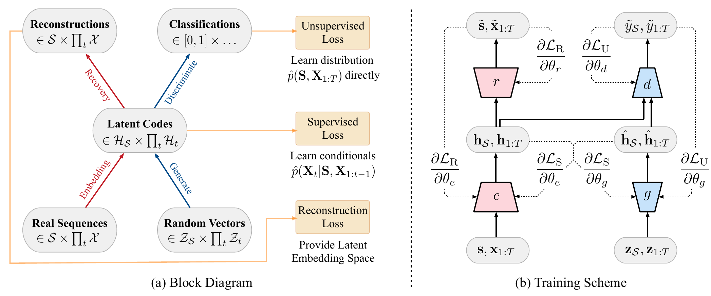
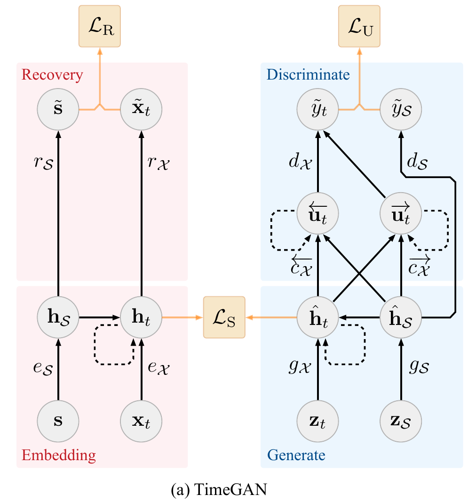
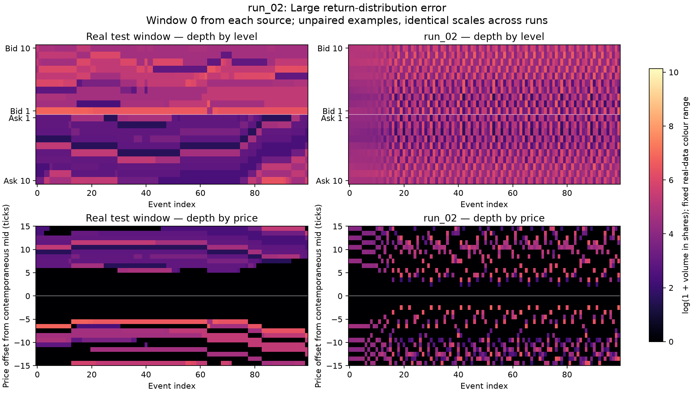
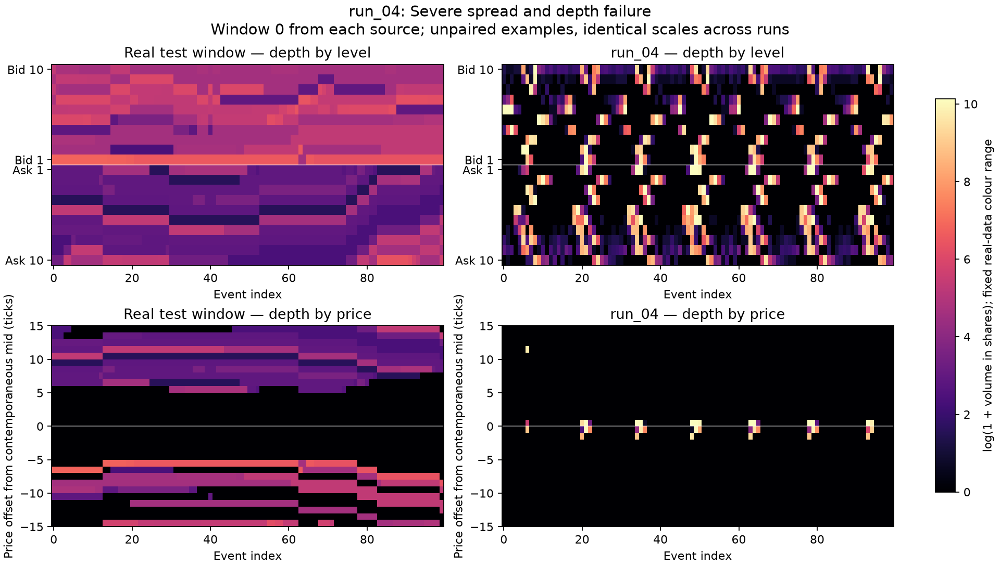
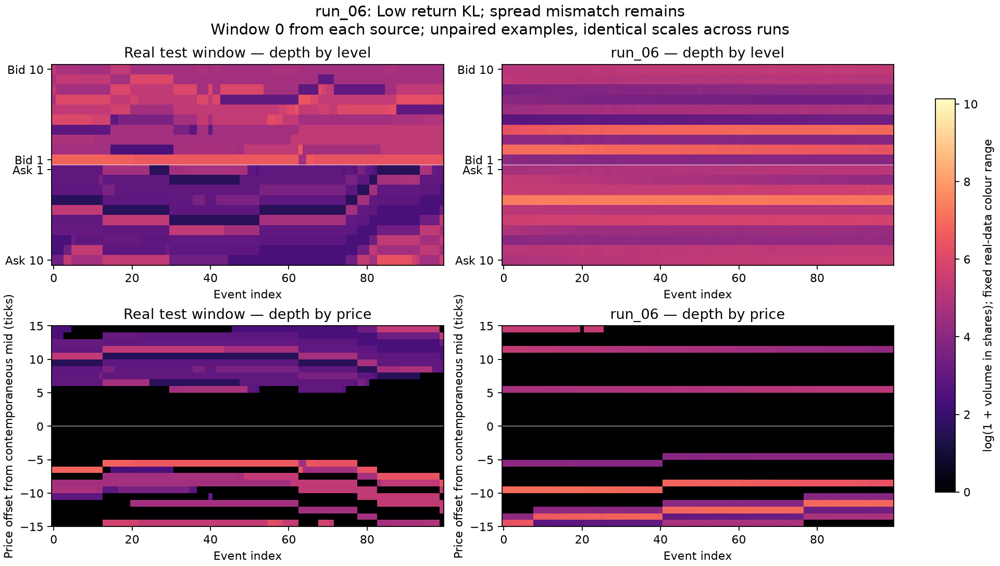
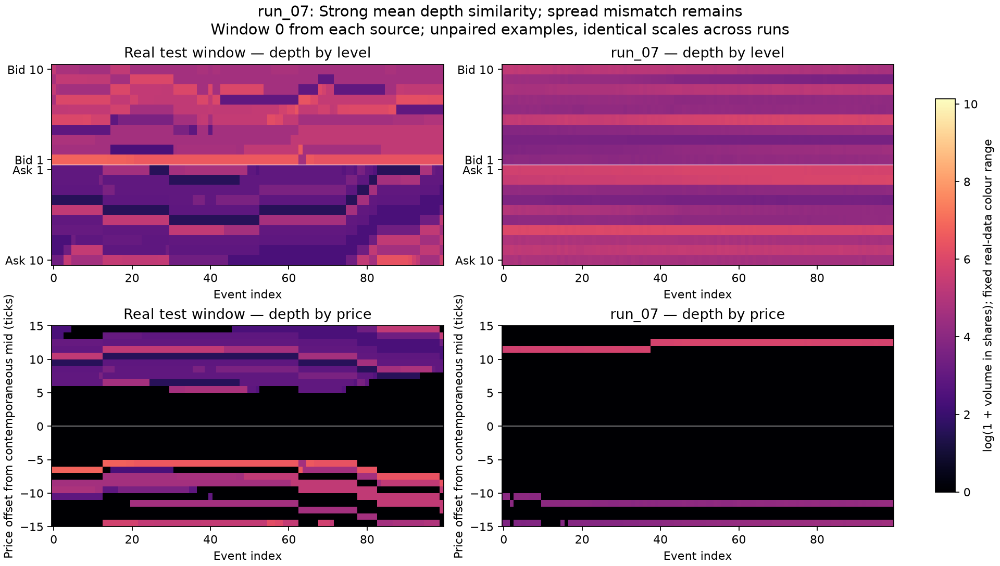
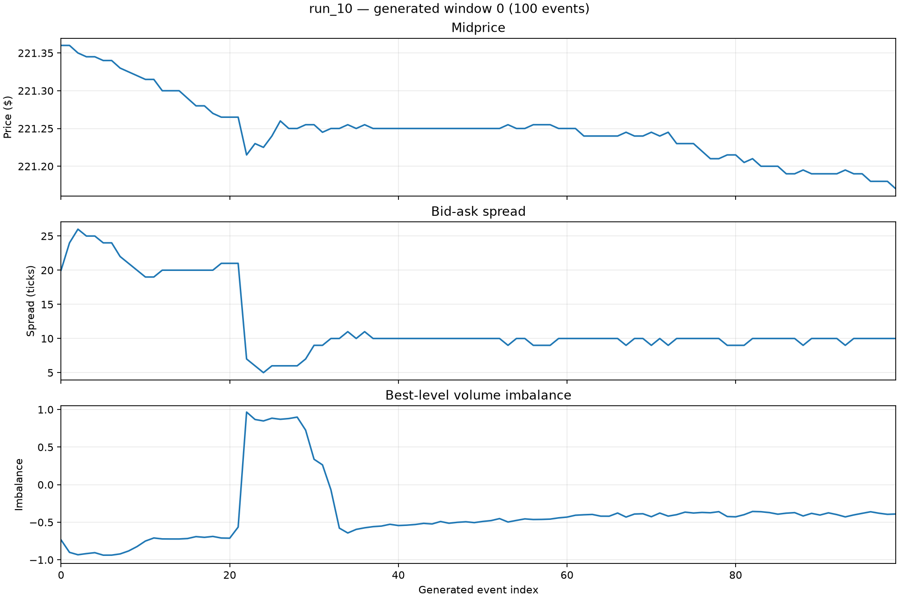
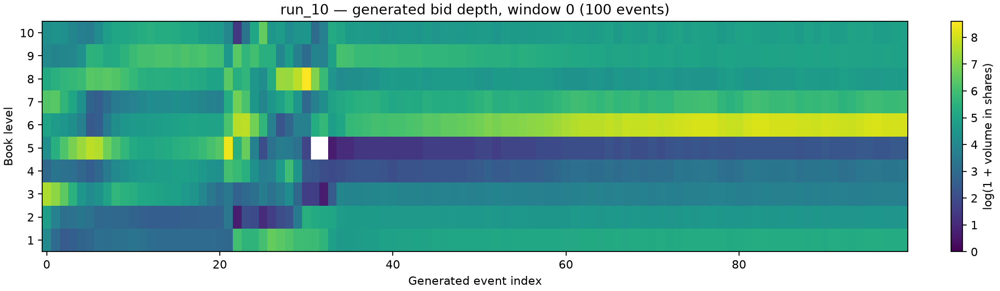
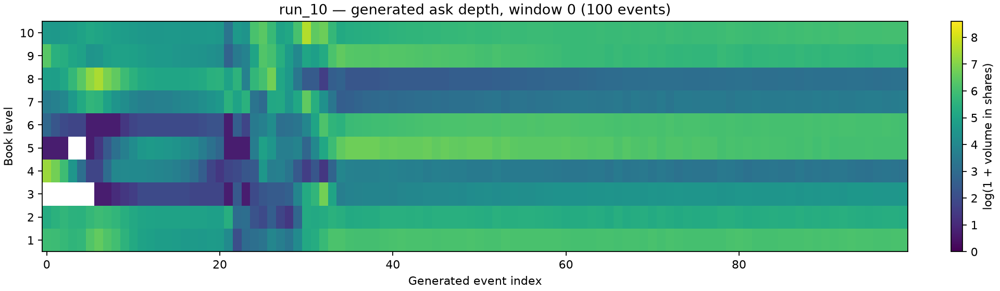
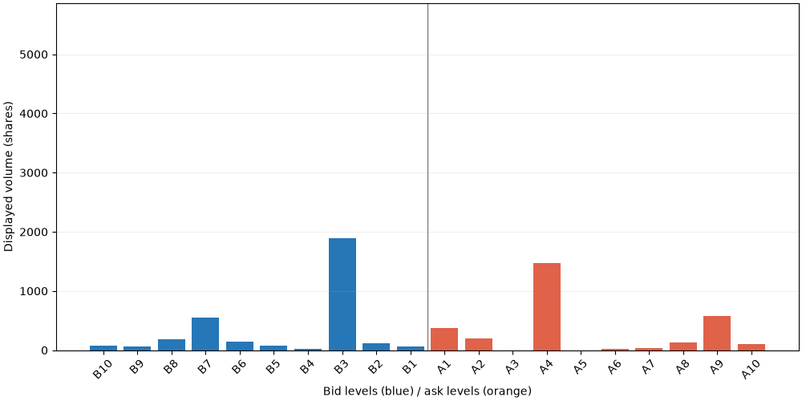

# TimeGAN limit-order-book experiments

TimeGAN generates 100-event limit-order-book sequences from LOBSTER AMZN data.

## Requirements

Runtime dependencies are listed in [requirements.txt](requirements.txt): PyTorch, NumPy, pandas, Matplotlib, scikit-image, and Pillow. The main pipeline runs on either the CPU or with CUDA. GPU training requires an NVIDIA driver and a compatible CUDA-enabled PyTorch build.

```bash
python3 -m venv venv
source venv/bin/activate
python -m pip install --upgrade pip
python -m pip install -r requirements.txt
```

## Usage

Run commands from the project directory with the environment activated.

### 1. Prepare data

```bash
python get_dataset.py
```

The default downloads and extracts the AMZN 2012-06-21 Level-10 sample into the data directory expected by [dataset.py](dataset.py). Internet access is required for this step. Alternatively, place the paired message/order-book CSV files in that local data directory. `python get_dataset.py --all` downloads all available samples; use the default single sample to match the reported experiment, since additional files change the dataset.

### 2. Train

Review the constants near the top of [train.py](train.py), including `CKPT_DIR`, batch size, epochs, and the hyperparameters below. Set a fresh local output directory for each experiment, then run:

```bash
python -u train.py
```

For Jupyter, select the project environment, use this directory as the working directory, and paste the complete file into a cell. Restart the kernel after changing imported model code. Training runs autoencoder pretraining, supervisor pretraining, and joint adversarial training. It saves the selected, periodic, and final model states with feature-scaling statistics and configuration. Stage timing and peak GPU-memory summaries are printed and saved locally.

### 3. Generate

Set `MODEL_FILE` to the trained model you want to use; the following path is a placeholder, not a bundled file:

```bash
export MODEL_FILE="/absolute/path/to/your/model.pt"
MPLBACKEND=Agg python predict.py "$MODEL_FILE" --samples 1000
```

[predict.py](predict.py) exports generated features, decoded order-book arrays and CSV data, and a snapshot figure. `--samples` controls the number of independently generated windows. Existing prediction outputs are replaced.

### 4. Evaluate

```bash
MPLBACKEND=Agg python evaluate.py "$MODEL_FILE"
```

[evaluate.py](evaluate.py) generates its own evaluation samples; running prediction first is optional. It prints KL, SSIM, and temporal diagnostics and saves a JSON summary and diagnostic figures locally. See [Evaluation script](#evaluation-script) for definitions and interpretation. CPU or GPU selection is automatic; on a cluster, run inside the GPU allocation and verify CUDA availability with:

```bash
python -c "import torch; print('CUDA available:', torch.cuda.is_available())"
```

## Model overview

The model adapts TimeGAN, introduced by Yoon, Jarrett, and van der Schaar in [*Time-series Generative Adversarial Networks* (NeurIPS 2019)](https://papers.neurips.cc/paper_files/paper/2019/hash/c9efe5f26cd17ba6216bbe2a7d26d490-Abstract.html), a recurrent generative adversarial framework for sequences. It learns both a representation of real order books and the temporal relationships between events. A generator then creates synthetic sequences in that learned representation, and a recoverer converts them back into order-book features. Generation starts from random noise; it does not require a real order-book window as input.

### Input features

Each input is a window of 100 consecutive events, with 42 features per event:

| Features | Representation | Purpose |
|---|---|---|
| Ask and bid prices at ten levels | 20 gaps measured in ticks | Describe book geometry relative to the midprice rather than absolute price. The first gap on each side is its distance from the midprice; deeper gaps are increments between levels. |
| Ask and bid volumes at ten levels | 20 `log(1 + volume)` values | Reduce the scale difference between small and large displayed sizes. |
| Midprice change | `asinh(change in ticks)` | Preserve the direction of price movement while reducing the influence of large moves. The first change in a window is zero. |
| Inter-event time | `log(1 + time in microseconds)` | Represent the wide range of delays between events. |

Each feature channel is standardised using a mean and standard deviation fitted on training data only. These same statistics are used for validation and generation. Empty levels and invalid price sentinels are handled during feature construction.

### Architecture

The implemented architecture uses 128 latent channels and 64 noise channels at each event. The recurrent layers are gated recurrent units (GRUs), which carry information from earlier events forward through the window.

| Component | Network | Role |
|---|---|---|
| Embedder | Two-layer GRU → linear layer → sigmoid | Maps 42 observed features into 128 learned latent channels per event. |
| Recoverer | Two-layer GRU → linear layer | Maps latent sequences back to 42 standardised features, with an unconstrained output. |
| Generator | Two-layer GRU → linear layer → sigmoid | Maps 64-channel random-noise sequences into synthetic latent sequences. |
| Supervisor | One-layer GRU → linear layer → sigmoid | Learns next-event latent dynamics and transforms the generator's latent output before recovery. |
| Discriminator | Two-layer GRU → linear layer | Produces real/fake logits at each event in latent space, providing the adversarial training signal. |



*Block diagram and training scheme, Figure 1 of [Yoon et al. (2019)](https://papers.neurips.cc/paper_files/paper/2019/file/c9efe5f26cd17ba6216bbe2a7d26d490-Paper.pdf). Solid arrows show data propagation; dashed arrows in the training scheme show gradient paths. Reconstruction, supervised, and adversarial objectives train complementary parts of the model.*



*Recurrent data flow, Figure 2(a) of the same paper. The static-feature branches labelled $s$ and $h_S$ are omitted in this order-book implementation, which models temporal features only. The paper's illustrated recoverer is feedforward and its discriminator bidirectional; this implementation uses a recurrent recoverer and a unidirectional discriminator. Its separate supervisor provides the next-step latent prediction described below.*

### How embedding and recovery work

For a batch of windows, the embedder changes the tensor shape from batch × 100 × 42 to batch × 100 × 128. Each latent vector reflects the current features and preceding events processed by the GRU. These channels are learned jointly rather than assigned to individual prices or volumes. This is a change of representation, not dimensional compression: the latent width is larger than the input width.

The recoverer processes that latent sequence and produces batch × 100 × 42 reconstructed features. Reconstruction training encourages embedding and recovery to retain the information needed to reproduce the original book. The supervisor is trained to predict the next real latent state from the sequence up to the current event, encouraging temporal structure beyond reconstruction alone.

During generation, noise passes through the generator, supervisor, and the same recoverer. The resulting features are first unstandardised, then converted to physical quantities: volume and time transforms are inverted, price changes are accumulated from an initial midprice, and price gaps are assembled into ask and bid levels. Sizes are rounded to integer shares and prices to the tick grid. The decoder enforces a spread of at least one tick and ordered deeper prices; these constraints come from decoding rules rather than proving the network learned them unaided.

### Equations and training objectives

The notation follows [Section 4 of the TimeGAN paper](https://papers.neurips.cc/paper_files/paper/2019/file/c9efe5f26cd17ba6216bbe2a7d26d490-Paper.pdf), specialised to temporal order-book features. The equations below distinguish the paper's framework from the actual losses in [modules.py](modules.py). Let $X=(x_1,\ldots,x_T)$ be a standardised window, with $x_t\in\mathbb{R}^{42}$ and $T=100$. Let $H=(h_1,\ldots,h_T)$ contain 128-channel latent vectors, and $Z$ contain 64-channel noise vectors. Expectations are estimated using training batches.

**Embedding and recovery.** Corresponding to the mappings in paper Eqs. (3)–(4):

$$
H=E_{\theta_E}(X),\qquad \widetilde X=R_{\theta_R}(H).
$$

$E$ learns a causal representation of the observed sequence; $R$ reconstructs its features. Both are GRU networks here, so an output at event $t$ may use preceding events. Following the reconstruction objective in paper Eq. (7), the implementation uses mean squared error over batch, event and feature dimensions:

$$
\mathcal L_R=\text{MSE}(X,\widetilde X).
$$

A low $\mathcal L_R$ means real sequences survive the embedding/recovery path; it does not establish that noise-generated sequences are realistic.

**Generation and supervision.** This implementation splits latent generation into a noise-driven generator $G$ and a supervisor $F$:

$$
\widehat E=G_{\theta_G}(Z),\qquad
\widehat H=F_{\theta_F}(\widehat E),\qquad
\widehat X=R_{\theta_R}(\widehat H).
$$

$\widehat E$ denotes the generator's intermediate latent output, not the embedder. The supervised objective follows the next-step latent-matching idea of paper Eq. (9), with the explicit alignment used in code:

$$
\mathcal L_S=\text{MSE}\!\left(F(H)_{1:T-1},H_{2:T}\right).
$$

The supervisor learns from real latent histories rather than only a discriminator's judgement. Its output at event $t$ targets the real latent vector at $t+1$; during generation it transforms the synthetic latent sequence.

**Adversarial learning.** Write $D(H)=\text{sigmoid}(d_{\theta_D}(H))$ for real probabilities. The temporal-only form of the paper's adversarial value function (Eq. (8)) is:

$$
V(D,G)=\mathbb E_X\!\left[\sum_t\log D(H)_t\right]
+\mathbb E_Z\!\left[\sum_t\log\!\left(1-D(\widehat H)_t\right)\right].
$$

The discriminator maximises this value while generation tries to fool it. Paper Eqs. (10)–(11) additionally combine reconstruction with $\lambda\mathcal L_S$ for embedding/recovery, and adversarial learning with $\eta\mathcal L_S$ for generation. Those are the framework's objectives, not the exact weighted expressions implemented here.

In code, $\text{BCE}$ averages binary cross-entropy over batch and events. It is evaluated directly on logits using `BCEWithLogitsLoss` for numerical stability. The discriminator also sees the generator output before supervision:

$$
\mathcal L_D=
\text{BCE}(D(H),1)
+\text{BCE}(D(\widehat H),0)
+\gamma\text{BCE}(D(\widehat E),0),
$$

$$
\mathcal L_A=
\text{BCE}(D(\widehat H),1)
+\gamma\text{BCE}(D(\widehat E),1),\qquad \gamma=1.
$$

The generator uses the non-saturating real-target loss $\mathcal L_A$, rather than directly minimising the logarithmic fake term in $V$. Real latent targets are detached during G/S updates; during discriminator updates both real and synthetic latent inputs are detached.

**Implemented joint objectives.** With the restored training preset and $\epsilon=10^{-8}$:

$$
\mathcal L_{E/R}=10\sqrt{\mathcal L_R+\epsilon}+0.1\mathcal L_S,
$$

$$
\begin{aligned}
\mathcal L_{G/F}={}&10\mathcal L_A+100\sqrt{\mathcal L_S+\epsilon}
+100\mathcal L_M+100\mathcal L_{\mathrm{diff}}\\
&+50\mathcal L_{\mathrm{corr}}+50\mathcal L_{\mathrm{ac}}
+50\mathcal L_{\mathrm{ac},H}+50\mathcal L_{\mathrm{within}}.
\end{aligned}
$$

$\mathcal L_M$ matches feature means and standard deviations across the batch at each event position. $\mathcal L_{\mathrm{diff}}$ matches average absolute event-to-event changes in feature and latent space. $\mathcal L_{\mathrm{corr}}$ matches feature correlation matrices; $\mathcal L_{\mathrm{ac}}$ and $\mathcal L_{\mathrm{ac},H}$ match autocorrelations at lags 1 and 2. $\mathcal L_{\mathrm{within}}$ matches within-window variability and correlations after centring each window. These extra statistical penalties are implementation choices, not additional equations claimed by the paper. Event and volatility additions are disabled in this preset.

Optimisation alternates between these objectives: E/R updates hold the supervisor fixed; G/F updates hold the discriminator fixed; D updates train only the discriminator. Pretraining instead uses $\mathcal L_R$ directly for E/R and $\mathcal L_S$ directly for the supervisor. Thus the square-root weighting belongs to joint training, not pretraining.

### Training stages

1. Reconstruction pretraining: train the embedder and recoverer to reproduce real features.
2. Supervisor pretraining: train next-event prediction on real latent sequences.
3. Joint training: alternate generator/supervisor, embedder/recoverer, and discriminator updates. Adversarial and statistical objectives encourage synthetic sequences to match real distributions and temporal behaviour. Optional volume-event reconstruction terms are available but disabled in the restored preset.

The embedder and discriminator are used during training; synthetic features are produced by the generator → supervisor → recoverer path. Training settings vary across experiments, so the results below compare runs rather than isolate a single architectural change.

## Training hyperparameters

| Setting | Value |
|---|---|
| Events per window / input features | 100 / 42 |
| Hidden width / noise width | 128 / 64 |
| GRU layers | 2 for E/R/G/D; 1 for the supervisor |
| Batch size | 128 |
| Optimiser | Adam, learning rate 0.001, betas (0.9, 0.999) |
| Initialisation | PyTorch defaults |
| Noise | Uniform marginals; half AR(1)-correlated with rho 0.7, half constant within each sequence |
| Moment matching | Across the batch at each timestep |
| Discriminator inputs | Raw latent values |
| Autoencoder / supervisor / joint epochs | 100 / 100 / 200 |
| Training batches per epoch | Up to 200, sampled without replacement |
| G/S and E/R updates per discriminator step | 2 each |
| Discriminator update threshold | Summed discriminator loss > 0.6 |
| Fake-generator discriminator branch coefficient (gamma) | 1 |
| EMA decay | 0.999 for generator, supervisor, and recoverer |
| Random seed | 69 |
| Scaler fitting stride | Every 10th training window |
| Validation subset | Up to 2,560 evenly spaced windows |
| Model selection | Minimum validation moment/roughness/correlation/autocorrelation/within-window discrepancy after epoch 30 |
| Validation generation warm-up | 0 events |

Effective joint generator/supervisor loss coefficients:

| Loss term | Coefficient |
|---|---:|
| Adversarial (including generator-only branch with gamma=1) | 10 |
| Square root of next-step latent MSE | 100 |
| Feature mean/std matching | 100 |
| Step-to-step roughness | 100 |
| Feature correlation | 50 |
| Feature autocorrelation | 50 |
| Latent autocorrelation | 50 |
| Within-window statistics | 50 |
| Global non-adversarial auxiliary multiplier | 1 |

Autoencoder pretraining uses reconstruction MSE. Supervisor pretraining uses next-step latent MSE. Joint E/R training uses `10 * sqrt(reconstruction MSE + epsilon) + 0.1 * latent next-step MSE`. 


## Results

Targets: KL <= 0.1 for spreads and returns, and SSIM > 0.6. KL is measured as `KL(real || generated)` using shared histograms.

| Run | KL spread | KL 1-step return | KL 10-step return | Mean SSIM levels | Mean SSIM prices | Pair SSIM levels | Pair SSIM prices |
|---|---:|---:|---:|---:|---:|---:|---:|
| run_01 | — | — | — | — | — | — | — |
| run_02 | 0.6169 | 1.4762 | 0.6853 | 0.7585 | 0.4444 | 0.0779 | 0.0516 |
| run_03 | 0.8011 | 0.4372 | 0.5783 | 0.5268 | 0.2261 | 0.1364 | 0.1240 |
| run_04 | 10.7452 | 4.0622 | — | 0.0337 | -0.0366 | 0.0107 | 0.0722 |
| run_05 | 4.4014 | 2.0789 | 10.6326 | 0.3577 | -0.0479 | 0.0096 | 0.1170 |
| run_06 | 0.3437 | 0.0595 | 0.0207 | 0.7645 | 0.6375 | 0.1019 | 0.1600 |
| run_07 | 0.1923 | 0.0783 | 0.0157 | 0.7955 | 0.7343 | 0.0897 | 0.1422 |
| run_08 | 0.4085 | 0.0952 | 0.0437 | 0.8123 | 0.5692 | 0.0999 | 0.1443 |
| **run_09** | **0.0986** | **0.0524** | **0.0433** | **0.8178** | **0.6929** | 0.1134 | 0.1457 |

run_09 meets all three KL targets and both mean-heatmap SSIM targets. run_06, run_07, and run_08 meet the return KL targets but miss the spread target. run_07 has the highest price-indexed mean SSIM among the runs shown.

Mean-heatmap SSIM compares average depth profiles across 500 windows. Pair SSIM compares individual, unpaired real and generated windows. These measure different properties: none of the runs shown achieves pair SSIM above 0.6. The mean-map results therefore do not establish realistic individual event dynamics.

`—` means unavailable. run_01 uses an earlier 40-feature representation and cannot be evaluated with the current 42-feature decoder. run_04 produces no usable ten-step return samples, so that entry is undefined rather than a pass.

## Microstructure diagnostics and error analysis

### Crossed and locked books

A crossed book has best bid greater than best ask, while a locked book has equal best quotes. Among decoded rows with occupied, valid best quotes, both rates are 0.00% for generated and real data. Valid best quotes occur in **99.796%** of generated rows and **100%** of real rows.
The absence of crossing is partly guaranteed by decoding: it enforces a spread of at least one tick, tick-aligned prices, and ordered deeper prices.

### Volatility clustering

Volatility clustering means that the **magnitude** of a price change remains dependent on earlier magnitudes, even when signed returns are weakly correlated. We measure autocorrelation of absolute midprice changes in ticks:

| Event lag | Real absolute-return autocorrelation | Generated absolute-return autocorrelation |
|---|---:|---:|
| 1 | 0.180 | 0.350 |
| 2 | 0.081 | 0.181 |
| 5 | 0.115 | 0.156 |
| 10 | 0.080 | 0.126 |

The generated series exhibits clustering, but overstates its strength. Lag-1 dependence is approximately twice the real value. Signed-return lag-1 autocorrelation is also more negative (−0.257 generated versus −0.151 real), indicating excessive short-term reversal. Matching return histograms does not constrain these temporal relationships sufficiently.

### Uncorrelated noise and partial collapse

The samples have substantial temporal dependence: pooled lag-1 spread autocorrelation is 0.967 generated versus 0.978 real. Log-volume lag-1 autocorrelation, computed per level over all windows and then averaged, is 0.872 versus 0.896. Together with nonzero absolute-return autocorrelation, this argues against a wholesale collapse into uncorrelated noise. It does not establish correct dynamics.

There is evidence of **attenuated within-window variation and overly similar path shapes**:

| Diagnostic | Real | Generated |
|---|---:|---:|
| Zero one-step return share | 91.27% | 80.41% |
| Median within-window spread standard deviation, ticks | 1.938 | 0.821 |
| Median within-window log-volume standard deviation, across windows/levels | 0.697 | 0.128 |
| Median number of volume levels changing per event, out of 20 | 1 | 17 |
| Unchanged volume-entry share between consecutive events | 88.32% | 18.60% |
| Mean spread-path correlation between randomly sampled distinct windows | 0.011 | 0.337 |

Generated books move too frequently while producing much smaller volume variation within each window. This combination is consistent with dense small fluctuations rather than realistic sparse book updates. The elevated correlation between generated spread paths suggests reduced temporal diversity. These observations support an under-dispersion/common-shape concern, but do not by themselves prove complete mode collapse or that noise is ignored.

## Next Steps 
- Configure model to train on all tickers, not just AMZN.
- Test feasibility of reusing model for orderbooks of differing widths

## Order-book examples

The following figures use generated window 0 and real test window 0 for every run. These are unpaired examples, chosen by index rather than visual quality. Each figure shows depth by level and depth by price relative to the contemporaneous midprice. Every figure uses the same real-data colour range and the same ±15-tick price band. Volumes outside the colour range saturate; prices outside the band are not displayed. Empty cells denote no displayed volume.

### run_02: large return-distribution mismatch

Spread and return KL exceed the targets. The two depth representations help distinguish a plausible average level profile from the placement of liquidity around the midprice.



### run_04: severe failure

Spread KL is 10.7452 and price-indexed mean SSIM is negative. The level view still exposes generated volume when the price-band view contains little or no displayed liquidity.
  - Added smoothing to moment calculation to fix flicker in run_02
  - Generator was ignoring discriminator output, added weights to discriminator loss



### run_06: improved returns, remaining spread mismatch

Both return KL scores pass, and both mean-map SSIM scores exceed 0.6. Spread KL remains 0.3437.
  - changed weights to observe hyper params



### run_07: strong average depth structure

Price-indexed mean SSIM reaches 0.7343. Return KL passes, while spread KL remains above target at 0.1923.
  - divergent generator losses
  - added ema for sampling



### run_09: strongest combined metric result

Spread KL is 0.0986, one-step return KL is 0.0524, and ten-step return KL is 0.0433. Mean SSIM is 0.8178 by level and 0.6929 by price. Individual-window similarity remains low despite these aggregate improvements.


## run_09: generated period

All figures and the animation below show generated window 0: 100 events, indexed 0–99, matching the run_09 order-book example and the generation horizon used for the reported metrics. Every event is displayed; these are generated-only views of the same window, not a longer extrapolated sequence. Event index is not clock time.







The animation displays all ten bid volumes (blue) and ten ask volumes (orange) at each of the 100 events. The volume axis stays fixed, and playback is 10 frames per second.



## Model and development notes

The representation expanded from 40 features in run_01 to 42 in the evaluated runs: ten levels of ask/bid price gaps and log volumes, plus asinh midprice change and log inter-event time. This supports explicit spread, return, and event-time analysis. Recovered source files establish the run_10 training preset listed above. Settings for the other early experiments are incomplete, so score differences cannot reliably be attributed to individual changes.

## Evaluation protocol

- Train: 09:30–13:00; validation: 13:00–14:30; test: 14:30–16:00, from the same AMZN trading day.
- Each evaluated run generates 500 windows with seed 123, a 20-event warm-up, the same quote decoder, and no sparsification.
- Spread KL uses real-data quantile bins; one-step return KL uses half-tick bins; ten-step return KL uses real-data quantile bins. All runs use the same real test reference.
- The figures illustrate single windows; the scores summarise the full evaluation set. Neither the figures nor passing histogram scores establish that event sparsity and temporal dependence are correct.

## Evaluation script

[evaluate.py](evaluate.py) evaluates a locally supplied trained model against real LOBSTER data. It generates fresh samples itself, so a separate prediction command is not required. Run it from the project directory, with the data available and dependencies including PyTorch, NumPy, pandas, Matplotlib, and scikit-image installed.

```bash
# Set MODEL_FILE to your local trained model before running.
MPLBACKEND=Agg python evaluate.py "$MODEL_FILE"
```

The model argument is optional; omitting it uses the generic local default in [predict.py](predict.py). The script loads the model's feature scaler and configuration, generates 500 windows of 100 events with seed 123 and a 20-event warm-up, and decodes them into order books. Each window starts at the initial midprice of its corresponding real test window. Real test windows are selected evenly across 14:30–16:00.

| Report | Interpretation |
|---|---|
| Spread KL | Distribution mismatch in bid–ask spread, measured in ticks. |
| One-step and ten-step return KL | Distribution mismatch in midprice changes over one and ten events, measured in ticks. |
| Inter-event-time KL | Distribution mismatch in transformed delays between events. |
| Real-vs-real KL reference | The same metric between interleaved halves of the real windows; indicates finite-sample variation. |
| Level-indexed SSIM | Similarity of log-volume depth heatmaps indexed by book level. |
| Price-indexed SSIM | Similarity of log-volume heatmaps in a ±15-tick band around the contemporaneous midprice. |
| Absolute-return autocorrelation | Real/generated volatility dependence at event lags 1–10. |
| Period comparisons | Generated-vs-train/validation/test KL and real period shifts, helping distinguish generation error from time-of-day changes. |

SSIM includes the mean of 300 randomly paired real/generated window scores, a real-vs-real reference, and the score between mean heatmaps. Pair scores and mean-map scores must be interpreted separately. Lower KL is better (target <= 0.1); higher SSIM is better (target > 0.6). These are aggregate diagnostics, not proof of realistic event-by-event dynamics.

The script prints metric tables and quantiles, writes a local JSON summary, and saves depth-heatmap and absolute-return-autocorrelation figures. Existing evaluation outputs are overwritten, so retain results separately when comparing runs. Evaluation does not update model parameters.

## Source files

- [dataset.py](dataset.py): LOBSTER loading, feature layout, and training-fitted standardisation.
- [modules.py](modules.py): recurrent networks, training objectives, and generation.
- [train.py](train.py): training stages, and validation.
- [predict.py](predict.py): model loading, feature decoding, and generated output formats.
- [evaluate.py](evaluate.py): distribution metrics, depth similarity, and temporal diagnostics.
- [get_dataset.py](get_dataset.py): helper to download all available LOBSTER datasets

## Feasibility Report

Hardware: 1 NVIDIA A100-PCIE-40GB
Runtime: PyTorch=2.140+cu130 | CUDAver=13.0 | dtype=torch.float32

| Stage | Epochs | Approximate elapsed time |
|---|---:|---:|
| Pretraining | 100 | ~225s |
| Joint adversarial training | 200 | ~2841s |
| Total Training Time | 400 | ~3060s |

peak_allocated_gib=0.8120121955871582 
peak_reserved_gib=1.720703125

- Intended User Scope -> backtesters
- Prototype Purpose -> creating useful data for quantitative analysis or backtesting algorithm
- Acceptance Criteria -> KL divergence (spreads/returns) <= 0.1, SSIM mean > 0.6
- Key Risks -> Sensitive divergence, unrepresentative volatility windows, crossed orderbooks

## References

Yoon, J., Jarrett, D., and van der Schaar, M. (2019). Time-series Generative Adversarial Networks. *Advances in Neural Information Processing Systems*, 32 (NeurIPS 2019). [Paper](https://papers.neurips.cc/paper_files/paper/2019/file/c9efe5f26cd17ba6216bbe2a7d26d490-Paper.pdf).

# Artificial Intelligence Usage Disclosure

AI (ChatGPT) was used in the following sections of this repo:
  - scaffolding model architecture, data loading, training and evaluation pipelines
  - writing documentation
  - writing visualisation and temporary scripts for performance analysis
